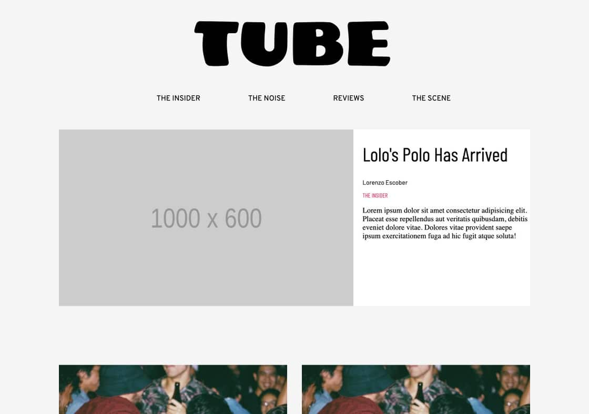

# Portfolio screens

Prepared for the Davin Cuaso portfolio on 6 November 2026.

Rendered from the repository HTML, CSS, fonts, and image assets at a 1280 × 900 viewport. Scripts and forms were disabled in the capture copy; initial reveal states were made visible. The project source itself is unchanged.

The screenshot preserves the original placeholder artwork and article content.

## Publication layout with original placeholder content

Source: [index.html](https://github.com/davincuaso/TUBERevamp/blob/302f0a8820617fe80b83ed093a4c09b810579a43/index.html), [css/main.css](https://github.com/davincuaso/TUBERevamp/blob/302f0a8820617fe80b83ed093a4c09b810579a43/css/main.css).

